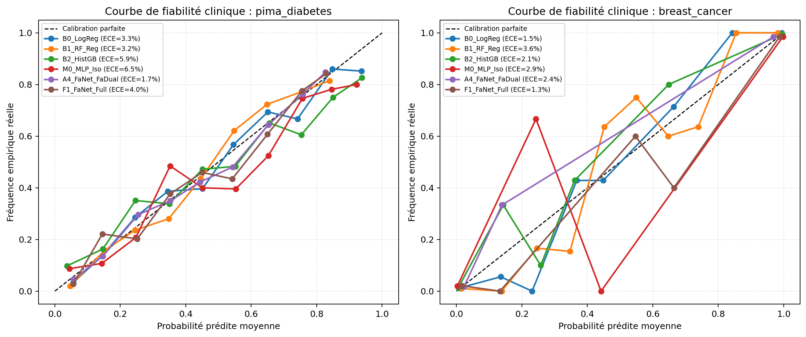
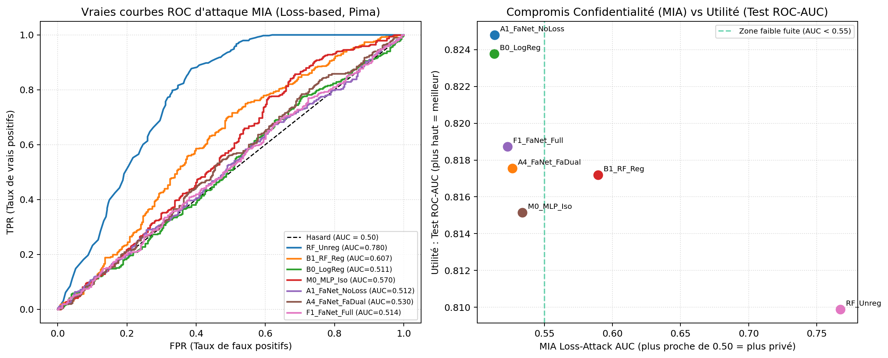
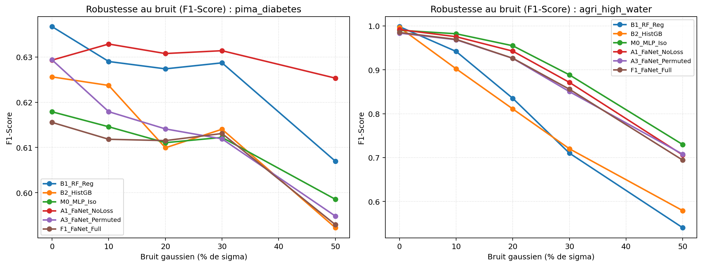

# MATRICE-256 (FaNet v4.2 / bokono)

**Framework d'Intelligence Artificielle Neuro-Symbolique fondé sur la combinatoire binaire du Fâ (Bénin)**

[](https://www.python.org/downloads/)
[](https://pypi.org/project/bokono/)
[](https://doi.org/10.5281/zenodo.24463045)
[](https://pytorch.org/)
[](https://github.com/CedBag/matrice-256#reconnaissance-internationale)
[-059669.svg)](https://github.com/CedBag/matrice-256#r%C3%A9sultats-exp%C3%A9rimentaux-v%C3%A9rifi%C3%A9s-kaggle-tesla-t4-v42)
[](https://github.com/CedBag/matrice-256/blob/main/LICENSE)

> **English Summary:** Matrice-256 (FaNet v4.2 / `bokono`) is a compact PyTorch neuro-symbolic framework (~2,361 trainable parameters, 30.2 KB ONNX export) built on the 8-bit binary combinatorics of the Beninese Fa system (16 Kpoli keys on the 4-bit binary hypercube `{-1, +1}^4`, 256 composite Du states via Kronecker attention). Selected in October 2026 as a representative case in the *AI Case Innovation Competition for African Youth* (FOCAC / China-BRICS AI Center, 114 selected out of 738 submissions across 47 African countries, Technological Progress track). Evaluated across 8 reproducible Kaggle Tesla T4 GPU benchmarks (5-Fold x 5 seeds = 25 paired runs with Wilcoxon signed-rank tests).

---

## Reconnaissance internationale

En **octobre 2026**, **Matrice-256 (FaNet)** a été sélectionné comme **cas représentatif** au *Concours créatif sur les cas d'application de l'intelligence artificielle à l'intention des jeunes des pays africains* (*AI Case Innovation Competition for African Youth*), organisé par le **Secrétariat du Comité de suivi chinois du Forum sur la Coopération Sino-Africaine (FOCAC)** et mis en oeuvre par le **China-BRICS Artificial Intelligence Development and Cooperation Center** :

- **Sélection globale** : 114 cas retenus sur 738 dossiers soumis dans 47 pays africains (taux de sélection d'environ 15,4 %).
- **Catégorie** : **Progrès technologique** (13 cas retenus sur 58 soumissions), publié aux pages 165 à 167 du recueil officiel (*Cas d'innovation en IA de la jeunesse africaine*).
- **Représentation nationale** : 1 des 7 projets béninois retenus dans le recueil.

---

## Architecture neuro-symbolique (FaNet v4.2)

**Matrice-256** formalise la combinatoire binaire 8 bits du **Fâ** (16 Kpoli sur 4 bits produisant `16 x 16 = 256` Du) comme un **biais inductif structurel** 100 % mathématique, public et reproductible :

1. **Embedding combinatoire sur hypercube 4 bits (`TorchFaEmbedding`)** :
   - Les 16 clés Kpoli forment exactement les 16 sommets de l'hypercube binaire `{-1, +1}^4` (`GBE = [+1,+1,+1,+1]`, ..., `IKA = [-1,-1,-1,-1]`).
   - Des requêtes combinées locale (par variable) et globale (cross-features) calculent deux attentions sur les 16 Kpoli puis forment la distribution sur les 256 Du par produit de Kronecker (`16 x 16`).
   - Normalisation lisse par sigmoïde ajustée strictement sur `X_train` (zéro fuite de données, zéro coupure des valeurs négatives).
2. **Bloc caché résiduel hybride (`FaReLU -> FaSigma`)** :
   - Un premier étage `FaReLU` (continue par morceaux) capture les frontières non linéaires nettes multi-variables.
   - Une branche résiduelle `TorchLearnableFaSigma` (interpolation lisse sur les 16 Kpoli) apporte la régularisation probabiliste, la calibration et la résistance au bruit.
3. **Perte ontologique factorisée (`FaImbalanceLoss`)** :
   - Les polarités binaires canoniques vérifient exactement `pol(i, j) = (pol(i) + pol(j)) / 2`, garantissant une identité algébrique exacte entre la polarité moyenne sur les 256 Du et les marginales sur 16 Kpoli en `O(16)`.
4. **Mode temporel BiLSTM et déploiement frugal** :
   - Mode séquentiel natif (`seq_len > 0`, BiLSTM), exécution locale hors-ligne (air-gapped), **2 361 paramètres** en mode tabulaire sur Pima Diabetes et export ONNX de **30,2 Ko**.

Documentation scientifique complète :
- [Livre blanc technique v4.2 (FR)](https://github.com/CedBag/matrice-256/blob/main/docs/whitepaper_matrice256.md)
- [Article académique v4.2 (EN)](https://github.com/CedBag/matrice-256/blob/main/docs/academic_paper_en.md)
- [Article académique v4.2 (FR)](https://github.com/CedBag/matrice-256/blob/main/docs/academic_paper_fr.md)
- [Rapport brut complet Kaggle Tesla T4](https://github.com/CedBag/matrice-256/blob/main/docs/benchmarks_v42_kaggle.md)

---

## Résultats expérimentaux vérifiés (Kaggle Tesla T4, v4.2)

Tous les résultats ci-dessous sont issus du protocole reproductible [tests/run_benchmark_v5.py](https://github.com/CedBag/matrice-256/blob/main/tests/run_benchmark_v5.py) exécuté sur **Kaggle GPU Tesla T4** (PyTorch `2.11.0+cu130`, `5-Fold x 5 seeds = 25 runs` appariés, tests statistiques de Wilcoxon, 79/79 tests unitaires `pytest` validés) :

| Expérience | Données et protocole | Résultat FaNet v4.2 (`F1_FaNet_Full`) | Comparaison aux baselines contrôlées |
|---|---|---|---|
| **Exp 1 : Biomédical (Breast Cancer)** | 569 patients, 30 biomarqueurs, 25 runs | **F1 0,9605, ROC-AUC 0,9949, PR-AUC 0,9935, Brier 0,0229** | Bat significativement `RF` et `HistGB` sur les 5 métriques (`p <= 0,045`) et `MLP` iso-paramètres en ROC-AUC (`p = 0,0037`) et PR-AUC (`p = 0,0046`) |
| **Exp 1 : Biomédical (Pima Diabetes)** | 768 patients, 8 biomarqueurs, 25 runs | **F1 0,6308 (+/- 0,042), ROC-AUC 0,8318, PR-AUC 0,7149** | Bat significativement `HistGB` (`p = 0,0001`) et `MLP` iso-paramètres (`ROC-AUC p = 0,0045`, `PR-AUC p = 0,0088`, `Brier p = 0,0061`) avec une variance F1 divisée par 2,5 |
| **Exp 1 : Agriculture multi-clusters** | 2 200 parcelles (`rice, jute, coconut`), 25 runs | **F1 0,9879, ROC-AUC 0,9999, PR-AUC 0,9994, ECE 0,38 %** | +12,4 points de F1 vs v4.1 ; équivalent statistique à `MLP` (`0,9899`, `p = 0,124`), ECE meilleure que `RF` (`0,83 %`, `p < 0,0001`) |
| **Exp 2 : Robustesse au bruit (50 %)** | Bruit gaussien sur test (5 folds x 5 tirages) | **Agri : F1 0,6943, ROC-AUC 0,9447** (`NoLoss` : `0,7061 / 0,9545`) | Surpasse fortement `RF` (`F1 0,5403`) et `HistGB` (`F1 0,5792`) à 50 % de bruit ; sur Pima à 50 % de bruit, `FaNet_NoLoss` domine tous les modèles (`F1 0,6253`, `PR-AUC 0,6701`) |
| **Exp 3 : Généralisation OOD sans fuite** | Train `rice`, Test `jute` et `maize`, négatifs disjoints | **Jute : Rappel 100 %, F1 100 % ; Maïs : Rappel 47,0 %, F1 60,5 %, ROC-AUC 1,000** | Sur Maïs, `RF` et `HistGB` tombent à `0 %`, et la permutation aléatoire de l'hypercube Fâ (`A3_Permuted`) chute de **-38,8 points F1** (`21,7 %`) |
| **Exp 4 : Calibration clinique réelle** | ECE pondérée standard (10 bins), OOF 5-Fold | **Breast Cancer : ECE 1,27 % (1er/6)** ; **Pima : 3,96 %** (`FaDual` : **1,73 %**, 1er/6) | Meilleure calibration clinique que `LogReg` (`1,50 %`), `HistGB` (`2,14 %`), `MLP` (`2,91 %`) et `RF` (`3,59 %`) sur Breast Cancer |
| **Exp 5 : Régression continue** | Sklearn Diabetes (réel) + Prix agricoles (FCFA) | **Prix : MAE 42,90 FCFA, R2 0,9476 ; Diabetes : MAE 45,32, R2 0,4561** | Bat `RF` (`43,41 FCFA` ; `46,94` sur Diabetes) et `Ridge` (`104,87 FCFA`) ; proche du plancher de bruit de Bayes (~40 FCFA) |
| **Exp 6 : Séries temporelles IoT** | Split chronologique strict + purge 18h, 5 seeds | **BiLSTM Fâ : F1 84,88 %, Rappel 93,16 %, ROC-AUC 0,9870** | Surpasse un **BiLSTM PyTorch standard** (`69,56 % F1`, `62,1 % Rappel`) de **+15,3 points F1** et `FaNet_NoLoss` (`80,19 %`) de +4,7 points (arbres : `RF 92,5 %`) |
| **Exp 7 : Confidentialité vs Utilité (MIA)** | Attaque par perte (Yeom 2018) sur Pima, 5 splits | **MIA Loss-AUC 0,5229, TPR@1%FPR 1,28 %** (`NoLoss` : `0,5133` / `ROC-AUC 0,8248`) | Compromis supérieur à `MLP` (`0,5337`), `RF_Reg` (`0,5895`) et `RF_Unreg` (`0,7674`), aligné avec l'esprit Privacy-by-Design (sans valoir certification juridique formelle) |
| **Exp 8 : Efficacité & ONNX (CPU)** | CodeCarbon par patient sur Pima (154 000 inf.) | **2 361 params, 30,2 Ko ONNX, 6,52 ms / 1k patients, 124,4 nWh/patient, F1 0,6449** | **7,3x plus rapide et -85,9 % d'énergie vs RF**, **-48,7 % vs HistGB**, meilleur F1 ; `MLP` reste plus rapide en latence pure (`0,61 ms`, `F1 0,5672`) |

### Figures authentiques (générées directement depuis les mesures Kaggle)







**Limites documentées honnêtement :**
- Sur des classes tabulaires extrêmement rares et séparables par seuils nets (`agri_rice`, 4,5 % positifs), les ensembles d'arbres (`RF 0,954`, `HistGB 0,948`) restent devant les réseaux neuronaux compacts (`FaNet 0,834`, `MLP 0,880`).
- Sur les 4 jeux de données en distribution (Exp 1), le gain face au `MLP` iso-paramètres et aux arbres provient principalement de l'architecture combinatoire sur hypercube et du bloc résiduel `FaReLU/FaSigma` ; l'effet propre de l'alignement des polarités sur l'hypercube (`F1_Full` vs `A3_Permuted`) se manifeste surtout en décalage de distribution (Exp 3 `OOD_maize` : `60,5 %` vs `21,7 %`) et en séries temporelles IoT (`84,9 %` vs `80,2 %` sans perte Fâ).
- En inférence CPU pure sur petit batch, un MLP dense minimal reste plus rapide (`0,61 ms / 1k` contre `6,52 ms / 1k` pour FaNet), le coût supplémentaire correspondant au calcul explicite de l'attention combinatoire 16x16.

---

## Démarrage rapide

### 1. Installation (via PyPI ou depuis les sources)

```bash
# Installation directe depuis PyPI (recommandée)
pip install -U bokono

# Avec les extras optionnels (benchmarks scientifiques ou interface Dash)
pip install "bokono[benchmark]"
pip install "bokono[ui]"
```

Ou depuis le dépôt GitHub pour reproduire les tests et benchmarks :

```bash
git clone https://github.com/CedBag/matrice-256.git
cd matrice-256
python -m venv .venv
# Linux / macOS : source .venv/bin/activate
# Windows PowerShell : .venv\Scripts\Activate.ps1
pip install -e ".[benchmark,dev]"
```

### 2. Exemple minimal (API PyTorch v4.2)

```python
import numpy as np
from bokono.ml.torch_network import TorchFaNet

# Données d'exemple (ex. 8 biomarqueurs)
X_train = np.random.randn(200, 8).astype(np.float32)
y_train = (X_train[:, 0] + X_train[:, 1] > 0).astype(np.float32)
X_test = np.random.randn(5, 8).astype(np.float32)

# Initialisation de FaNet v4.2 (hypercube 4 bits + bloc résiduel FaReLU/FaSigma)
model = TorchFaNet(n_features=8, hidden_dim=32, n_outputs=1, dropout=0.1, seed=42)

# Entraînement supervisé avec pénalité ontologique (lambda_fa)
model.fit(X_train, y_train, epochs=40, lr=0.005, optimizer="adamw", lambda_fa=0.1, verbose=False)

# Inférence avec état symbolique Fâ associé
probabilities, interpretations = model.predict(X_test)
print(probabilities[0])
print(interpretations[0]["ontological_state"])  # ex: STATE_017
print(interpretations[0]["system_polarity"])    # FAVORABLE / NEUTRE / DEFAVORABLE
```

### 3. Reproduire les tests et benchmarks (local ou Kaggle GPU)

```bash
# Suite de 79 tests unitaires
pytest tests/test_week1.py tests/test_v03.py tests/test_v30.py -v

# Exécution rapide locale (mode --quick)
python tests/run_benchmark_v5.py --quick

# Exécution complète (recommandée sur GPU Kaggle via kaggle/matrice256_kaggle_v5.ipynb)
python tests/run_benchmark_v5.py --device auto --out-dir results_v42 --zip-path results_v42.zip
```

---

## Structure du dépôt

- `bokono/core/` : encodeur binaire Fâ (`fa_encoder.py`), matrice 16x16 (`fa_matrix.py`) et base mathématique publique alignée (`fa_knowledge_public.json`).
- `bokono/ml/` : couches PyTorch v4.2 (`TorchFaEmbedding` hypercube 4 bits, `TorchFaHidden`, `TorchFaDecoder`), `FaImbalanceLoss`, `TorchFaNet` (tabulaire et BiLSTM) et activations continues (`FaReLU`, `TorchLearnableFaSigma`).
- `data_poc/` : jeux de données réels PoC (`sante_dataset.csv`, `agri_dataset.csv`).
- `docs/` : livre blanc v4.2, articles académiques FR/EN, rapport brut Kaggle (`benchmarks_v42_kaggle.md`) et figures authentiques (`docs/figures/`).
- `kaggle/` : notebook GPU clé en main (`matrice256_kaggle_v5.ipynb`) pour reproduire l'intégralité des 8 expériences sur Tesla T4.
- `tests/` : tests unitaires (`pytest`) et suite scientifique complète (`run_benchmark_v5.py`).
- `LICENSE` / `pyproject.toml` : licence de recherche académique et configuration du package `bokono` v4.2.0.

---

## Citation

Si vous évaluez ou citez ce travail dans un contexte académique :

```bibtex
@software{bagbonon2026matrice256,
  author       = {Bagbonon, Cedoque},
  title        = {Matrice-256 (FaNet v4.2 / bokono): A Neuro-Symbolic AI Framework Based on Beninese Fa 4-Bit Binary Hypercube Combinatorics},
  year         = {2026},
  month        = nov,
  version      = {4.2.0},
  publisher    = {Zenodo},
  doi          = {10.5281/zenodo.24463045},
  url          = {https://doi.org/10.5281/zenodo.24463045},
  note         = {GitHub: https://github.com/CedBag/matrice-256 | PyPI: https://pypi.org/project/bokono/ | Selected as a representative case in the AI Case Innovation Competition for African Youth (FOCAC / China-BRICS AI Center, October 2026)}
}
```

---

## Licence et contact

Ce dépôt est distribué sous **Licence de Recherche Académique et d'Évaluation** (voir [LICENSE](https://github.com/CedBag/matrice-256/blob/main/LICENSE)) : la lecture, l'audit, la vérification scientifique par les pairs et l'expérimentation locale non commerciale sont autorisés. Toute utilisation commerciale, redistribution ou exploitation industrielle requiert un accord écrit préalable.

- **Auteur** : Cedoque BAGBONON (Projet Matrice-256, Bénin)
- **Contact** : `projet.matrice256@protonmail.com`
