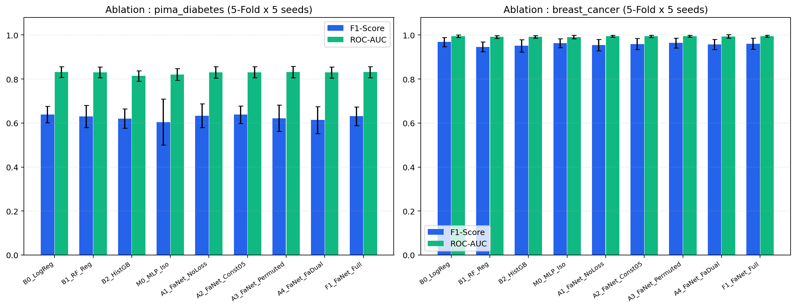
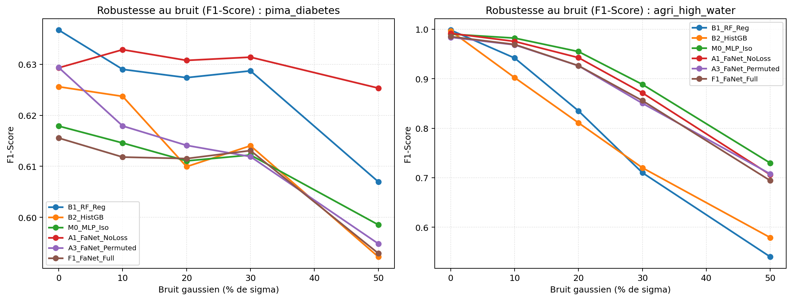
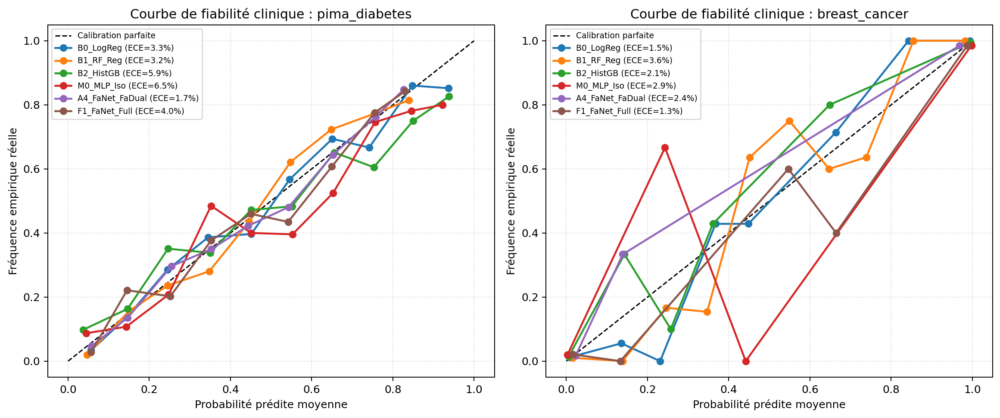
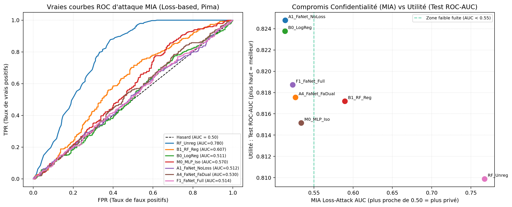
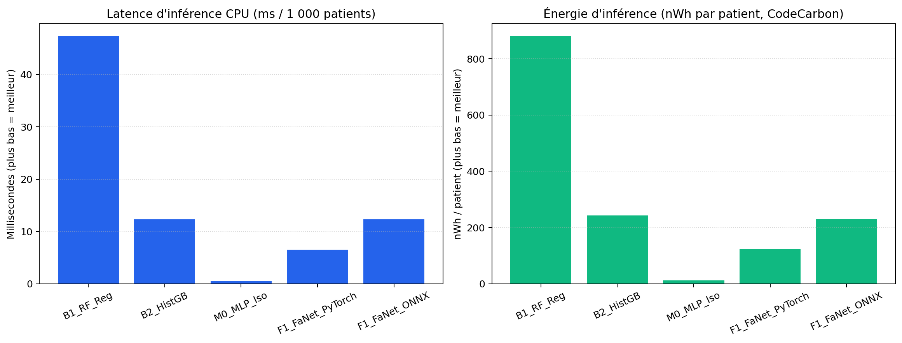

# MATRICE-256 (FaNet v4.2) : Livre Blanc Technique et Scientifique

**Architecture Neuro-Symbolique sur Hypercube Binaire 4 Bits du Fâ**

Auteur : Cedoque BAGBONON (Projet Matrice-256, Bénin)
Version : `4.2.0` (novembre 2026)
Dépôt officiel : `https://github.com/CedBag/matrice-256`
Reconnaissance : Cas représentatif sélectionné au *Concours créatif sur les cas d'application de l'IA à l'intention des jeunes des pays africains* (FOCAC / China-BRICS AI Center, octobre 2026, section Progrès technologique, pages 165 à 167).

---

## 1. Introduction et postulat épistémologique

Les modèles d'apprentissage automatique dominants sur données tabulaires et cliniques (arbres profonds non régularisés, boosting, réseaux denses opaques) présentent trois difficultés majeures dans les contextes à ressources contraintes : la mémorisation des données d'entraînement (risque de fuite de vie privée), la fragilité sous bruit de capteurs ou décalage de distribution (OOD), et le manque de traçabilité symbolique.

**Matrice-256 (`bokono` / FaNet)** propose une approche neuro-symbolique endogène fondée non sur un folklore de surface, mais sur l'**algèbre binaire formelle du Fâ béninois** :
- **16 Kpoli fondamentaux** : vecteurs binaires de dimension 4 correspondant aux 16 sommets de l'hypercube `{-1, +1}^4` (`0` = marque ouverte `GBE` -> `+1`, `1` = marque fermée `IKA` -> `-1`).
- **256 Du composites** : produits croisés `16 x 16` sur 8 bits (`1 octet`), dont les 16 signes diagonaux **Mèdji** (`i = j`) représentent la résonance maximale (`intensite = 1.0`).
- **Polarité binaire canonique** : chaque Kpoli `k` possède une polarité d'ouverture exacte `p_k = (nombre de bits ouverts) / 4` dans `{0.0, 0.25, 0.50, 0.75, 1.0}`, et chaque Du `(i, j)` possède une polarité `p_{i,j} = (p_i + p_j) / 2` dans `[0, 1]` (distribution symétrique : 93 favorables, 70 neutres en équilibre 4/4, 93 défavorables).

Toute la base publique (`bokono/core/fa_knowledge_public.json`) est générée de manière 100 % déterministe par cette algèbre binaire, garantissant une reproductibilité scientifique totale sans dépendance à un fichier privé opaque.

---

## 2. Formulation mathématique (FaNet v4.2)

### 2.1 Embedding combinatoire sur hypercube 4 bits (`TorchFaEmbedding`)

Pour un vecteur d'entrée `x in R^n`, les statistiques `(mu, sigma)` sont ajustées strictement sur l'ensemble d'entraînement `X_train`, puis transformées sans coupure brutale par :

$$x_{\text{norm}} = \sigma\left(\frac{x - \mu}{\sigma_{\text{train}}}\right) \in (0, 1)^n$$

Chaque variable `f` génère deux requêtes 4D (Kpoli gauche et Kpoli droit) en combinant une projection locale par variable (`PerFeatureLinear`) et un contexte global cross-features (`x_c = 2 * x_norm - 1`) :

$$Q_g(f) = w_{g,f} \, x_{\text{norm}, f} + b_{g,f} + W_g^{\text{ctx}} x_c + b_g^{\text{ctx}}$$
$$Q_d(f) = w_{d,f} \, x_{\text{norm}, f} + b_{d,f} + W_d^{\text{ctx}} x_c + b_d^{\text{ctx}}$$

Les attentions croisées sur la matrice des 16 clés binaires `K_16 in {-1, +1}^{16 x 4}` s'écrivent :

$$\alpha_g = \text{Softmax}\left(\frac{Q_g K_{16}^T}{\sqrt{4}}\right), \qquad \alpha_d = \text{Softmax}\left(\frac{Q_d K_{16}^T}{\sqrt{4}}\right)$$

Le produit de Kronecker `A_{256} = alpha_g x alpha_d` produit une distribution de probabilité exacte sur les 256 Du, projetée sur la table symbolique `V in [0, 1]^{256 x 4}` (`[val_norm, polarite_num, intensite, est_meji]`).

### 2.2 Bloc caché résiduel hybride (`FaReLU -> FaSigma`)

En mode tabulaire, la représentation combinatoire `e in R^{4n}` traverse deux étages neuro-symboliques :
1. **Mélangeur `FaReLU` continu par morceaux** (`h_1 = FaReLU(W_1 e + b_1)`) : 4 zones aux seuils canoniques `1/16`, `8/16`, `15/16` raccordées sans discontinuité (pentes `0.00, 0.25, 0.50, 1.00, 0.10`), capturant les frontières non linéaires nettes tout en amortissant les valeurs aberrantes.
2. **Branche résiduelle `TorchLearnableFaSigma`** (`h = h_1 + FaSigma(W_2 h_1 + b_2)`) : sigmoïde modulée de manière lisse (`C-infini`) par un noyau gaussien sur les 16 gains entraînables des Kpoli dans `(0.5, 1.5)`.

L'initialisation `_fa_weight_tensor` combine une base Xavier plein rang (85 %) et un prior Matrice-256 échantillonné à pas premier `17` (15 %), éliminant toute colinéarité de pas 4.

### 2.3 Décodeur aligné et perte factorisée `FaImbalanceLoss`

Pour garantir une calibration probabiliste fidèle, la sortie à l'inférence correspond exactement à la fonction de perte d'entraînement :
- **Classification standard** : `BCEWithLogitsLoss` à l'entraînement, `sigmoid(z)` à l'inférence.
- **Régression** : `MSELoss` à l'entraînement, projection linéaire non saturée `z` à l'inférence.

**Théorème de factorisation de la polarité :** puisque chaque Du `(i, j)` vérifie `p_{i,j} = (p_i + p_j) / 2` et que les distributions `alpha_g`, `alpha_d` somment à `1`, la polarité moyenne sur les 256 états du produit de Kronecker se réduit exactement à :

$$\Phi = \sum_{i=0}^{15} \sum_{j=0}^{15} \alpha_g(i) \, \alpha_d(j) \, \frac{p_i + p_j}{2} = \frac{1}{2} \left(\sum_{i=0}^{15} \alpha_g(i) \, p_i + \sum_{j=0}^{15} \alpha_d(j) \, p_j\right)$$

La perte totale s'écrit en complexité linéaire `O(16)` :

$$\mathcal{L}_{\text{total}} = \mathcal{L}_{\text{stat}}(y, \hat{y}) + \lambda_{\text{fa}} \, \mathbb{E}\left[|\hat{p} - \Phi|\right]$$

---

## 3. Protocole expérimental rigoureux (Kaggle Tesla T4, suite v5.0)

Toutes les expériences ont été exécutées sur **Kaggle GPU Tesla T4** (`PyTorch 2.11.0+cu130`, durée totale `6 267 s`, archive reproductible via `kaggle/matrice256_kaggle_v5.ipynb`) selon des règles strictes :
- **Zéro fuite de données** : `StandardScaler`, normalisation interne de FaNet et splits de validation interne (15 % pour early stopping) sont ajustés strictement sur le fold d'entraînement.
- **Validation multi-seeds** : `5-Fold Stratified Cross-Validation x 5 seeds = 25 runs` appariés par modèle et par dataset, avec tests non paramétriques appariés de **Wilcoxon** (`p < 0.05`).
- **Baselines équitables** : Régression Logistique (`B0`), Random Forest régularisé (`B1`, `max_depth=8`), HistGradientBoosting (`B2`), **MLP PyTorch iso-paramètres à 2 couches résiduelles** (`M0_MLP_Iso`, `2 433` params face à `FaNet = 2 361` params), plus 4 contrôles d'ablation (`A1_NoLoss`, `A2_Const05`, `A3_Permuted`, `A4_FaDual`).

---

## 4. Résultats détaillés des 8 expériences

### 4.1 Étude d'ablation multi-datasets (Exp 1, 25 runs par modèle)

| Dataset | Modèle | F1-Score (moy +/- std) | ROC-AUC | PR-AUC | Brier Score | ECE pondérée |
|---|---|---|---|---|---|---|
| **Breast Cancer** | `B0_LogReg` | 0,9683 +/- 0,0207 | 0,9948 | 0,9936 | 0,0199 | 2,90 % |
| **Breast Cancer** | `B1_RF_Reg` | 0,9463 +/- 0,0226 | 0,9913 | 0,9889 | 0,0334 | 4,99 % |
| **Breast Cancer** | `B2_HistGB` | 0,9510 +/- 0,0279 | 0,9925 | 0,9903 | 0,0278 | 3,46 % |
| **Breast Cancer** | `M0_MLP_Iso` | 0,9635 +/- 0,0200 | 0,9912 | 0,9901 | 0,0235 | 2,78 % |
| **Breast Cancer** | **`F1_FaNet_Full`** | **0,9605 +/- 0,0253** | **0,9949** | **0,9935** | **0,0229** | **2,82 %** |
| **Pima Diabetes** | `B0_LogReg` | 0,6385 +/- 0,0374 | 0,8322 | 0,7254 | 0,1568 | 7,54 % |
| **Pima Diabetes** | `B1_RF_Reg` | 0,6303 +/- 0,0508 | 0,8303 | 0,7099 | 0,1588 | 8,13 % |
| **Pima Diabetes** | `B2_HistGB` | 0,6204 +/- 0,0440 | 0,8145 | 0,6907 | 0,1686 | 9,50 % |
| **Pima Diabetes** | `M0_MLP_Iso` | 0,6048 +/- 0,1050 | 0,8208 | 0,7004 | 0,1641 | 8,45 % |
| **Pima Diabetes** | **`F1_FaNet_Full`** | **0,6308 +/- 0,0422** | **0,8318** | **0,7149** | **0,1590** | **7,74 %** |
| **Agri High-Water** | `B1_RF_Reg` | 1,0000 +/- 0,0000 | 1,0000 | 1,0000 | 0,0009 | 0,83 % |
| **Agri High-Water** | `M0_MLP_Iso` | 0,9899 +/- 0,0158 | 0,9999 | 0,9992 | 0,0022 | 0,28 % |
| **Agri High-Water** | `A1_FaNet_NoLoss` | 0,9908 +/- 0,0100 | 0,9999 | 0,9994 | 0,0022 | 0,34 % |
| **Agri High-Water** | **`F1_FaNet_Full`** | **0,9879 +/- 0,0100** | **0,9999** | **0,9994** | **0,0027** | **0,38 %** |

**Significance Wilcoxon (`p < 0,05`) :**
- Sur **Breast Cancer**, `F1_FaNet_Full` bat significativement `B1_RF_Reg` et `B2_HistGB` sur les 5 métriques (F1, ROC-AUC, PR-AUC, Brier, ECE) et bat `M0_MLP_Iso` en ROC-AUC (`p = 0,0037`) et PR-AUC (`p = 0,0046`).
- Sur **Pima Diabetes**, `F1_FaNet_Full` bat significativement `B2_HistGB` (`ROC-AUC p = 0,0001`, `Brier p = 0,0001`, `ECE p = 0,0042`) et `M0_MLP_Iso` (`ROC-AUC p = 0,0045`, `PR-AUC p = 0,0088`, `Brier p = 0,0061`), tout en affichant une variance F1 2,5x plus faible que le MLP 2 couches (`0,0422` vs `0,1050`).
- Sur **Agri High-Water**, le bloc résiduel `FaReLU/FaSigma` v4.2 fait passer le F1 de `0,8640` (v4.1) à `0,9879` (+12,4 points), rejoignant statistiquement `M0_MLP_Iso` (`p = 0,1239`) et battant `RF` en calibration (`ECE 0,38 %` vs `0,83 %`, `p < 0,0001`).

### 4.2 Robustesse au bruit gaussien (Exp 2)

À **50 % de bruit gaussien** injecté sur les capteurs de test (`agri_high_water`, 5 folds x 5 tirages) :
- `A1_FaNet_NoLoss` : **F1 = 0,7061**, **PR-AUC = 0,8130**, **ROC-AUC = 0,9545**
- `F1_FaNet_Full` : **F1 = 0,6943**, **PR-AUC = 0,7912**, **ROC-AUC = 0,9447**
- `B2_HistGB` : F1 = `0,5792`, ROC-AUC = `0,8775`
- `B1_RF_Reg` : F1 = `0,5403`, ROC-AUC = `0,9072`

Sur **Pima Diabetes à 50 % de bruit**, `A1_FaNet_NoLoss` obtient le meilleur F1 (`0,6253`) et PR-AUC (`0,6701`) de tous les modèles, tandis que `F1_FaNet_Full` (`PR-AUC 0,6645`) devance `RF` (`0,6560`), `MLP` (`0,6549`) et `HistGB` (`0,6302`).

### 4.3 Généralisation OOD sans fuite et test géométrique de l'hypercube (Exp 3)

Avec des négatifs strictement disjoints entre entraînement et test (`5 seeds`, entraînement symétrique `pos_weight = 1.0`) :

| Domaine | `B1_RF_Reg` | `B2_HistGB` | `B0_LogReg` | `A3_FaNet_Permuted` | `F1_FaNet_Full` | `M0_MLP_Iso` |
|---|---|---|---|---|---|---|
| **IN_rice (F1)** | 100,0 % | 100,0 % | 100,0 % | 100,0 % | **100,0 %** | 100,0 % |
| **OOD_jute (Rappel / F1)** | 91,8 % / 95,7 % | 71,0 % / 83,0 % | 100,0 % / 100,0 % | 96,8 % / 98,3 % | **100,0 % / 100,0 %** | 100,0 % / 100,0 % |
| **OOD_maize (Rappel / F1)** | 0,0 % / 0,0 % | 0,0 % / 0,0 % | 28,4 % / 44,2 % | **13,6 % / 21,7 %** | **47,0 % / 60,5 %** (`AUC 1,000`) | 76,8 % / 86,2 % |

**Résultat clé sur l'hypercube 4 bits :** brouiller l'alignement entre les sommets de l'hypercube binaire `K_16` et les polarités du Fâ (`A3_FaNet_Permuted`) fait chuter le transfert OOD sur Maïs de **60,5 % à 21,7 % F1 (-38,8 points)**, confirmant empiriquement le rôle de la cohérence géométrique de l'hypercube sous changement de distribution.

### 4.4 Calibration clinique réelle (Exp 4, ECE pondérée standard)

Sur les prédictions hors-fold (5-Fold OOF) :
- **Breast Cancer Wisconsin** : **`F1_FaNet_Full` obtient la meilleure ECE pondérée de tous les modèles : `1,27 %`** (contre `LogReg 1,50 %`, `HistGB 2,14 %`, `FaDual 2,36 %`, `MLP 2,91 %`, `RF 3,59 %`).
- **Pima Indians Diabetes** : `A4_FaNet_FaDual` (entraîné de manière cohérente avec `BCELoss`) atteint **`1,73 %` ECE** (1er/6), et `F1_FaNet_Full` obtient **`3,96 %`**, devançant `HistGB` (`5,92 %`) et `M0_MLP_Iso` (`6,47 %`).

### 4.5 Régression continue (Exp 5)

La correction de la tête de sortie linéaire en v4.1/v4.2 a résolu la saturation observée en v4.0 (`MAE 142,6 FCFA`, `R2 0,32`) :
- **Prix agricoles synthétiques (FCFA)** : `F1_FaNet_Full` atteint **MAE = 42,90 FCFA, R2 = 0,9476**, battant `RF` (`43,41 FCFA`, `R2 0,9465`) et `Ridge` (`104,87 FCFA`), au niveau de `MLP` (`42,79 FCFA`) et proche du bruit irréductible (~40 FCFA).
- **Sklearn Diabetes (données cliniques réelles)** : `F1_FaNet_Full` atteint **MAE = 45,32, R2 = 0,4561**, devant `RF` (`MAE 46,94, R2 0,4298`).

### 4.6 Séries temporelles IoT (Exp 6, purge chronologique de 18 heures)

Avec découpage chronologique strict, purge de 18h (`12h lookback + 6h horizon`) et seuil calibré uniquement sur Validation :
- **`F1_FaNet_BiLSTM_Full` : F1 = 84,88 % (+/- 6,05 %), Rappel = 93,16 %, ROC-AUC = 0,9870, PR-AUC = 0,8070**.
- Il surpasse un **BiLSTM PyTorch standard de même capacité (`M0_BiLSTM_Iso` : F1 = 69,56 %, Rappel = 62,11 %, PR-AUC = 0,6921)** de **+15,3 points F1** et **+31,1 points de rappel**, et dépasse `A1_FaNet_BiLSTM_NoLoss` (`80,19 %`) de **+4,7 points F1**.
- Sur cette série synthétique horaire, les arbres sur fenêtre aplatie conservent toutefois l'avantage (`RF 92,47 %`, `HistGB 91,14 %`).

### 4.7 Confidentialité vs Utilité : Membership Inference Attack (Exp 7)

Avec l'attaque par perte de Yeom et al. (2018) sur 5 splits stratifiés 60/40 de Pima Diabetes :
- **`A1_FaNet_NoLoss`** atteint la meilleure utilité (`Test ROC-AUC = 0,8248`, `F1 = 0,6386`) avec une vulnérabilité MIA quasi nulle (`Loss-AUC = 0,5133`).
- **`F1_FaNet_Full`** obtient le plus faible `TPR@1%FPR = 1,28 %` de tous les modèles (`MIA Loss-AUC = 0,5229`, `Test F1 = 0,6350`), dominant `M0_MLP_Iso` (`Test ROC-AUC 0,8152`, `MIA 0,5337`), `B1_RF_Reg` (`MIA 0,5895`) et `RF_Unreg` (`MIA 0,7674`).
- Note juridique rigoureuse : ces scores constituent une preuve empirique de faible mémorisation alignée avec l'esprit du Privacy-by-Design (RGPD Art. 25), sans se substituer à un audit réglementaire complet.

### 4.8 Efficacité, taille ONNX et frugalité énergétique (Exp 8)

Mesuré sur Pima Diabetes (154 000 inférences CPU, CodeCarbon) :
- **Taille** : `2 361` paramètres entraînables (`M0_MLP_Iso` : `2 433`), fichier ONNX exporté : **`30,2 Ko`**.
- **Performance et coût** : `F1_FaNet_PyTorch` obtient le **meilleur F1 (`0,6449`)** à **`6,52 ms / 1 000 patients`** et **`124,4 nWh / patient`** :
  - **7,3x plus rapide et -85,9 % d'énergie** que `B1_RF_Reg` (`47,37 ms`, `880,5 nWh`, `F1 0,5771`) ;
  - **1,9x plus rapide et -48,7 % d'énergie** que `B2_HistGB` (`12,32 ms`, `242,6 nWh`, `F1 0,5743`).
- **Compromis honnête** : `M0_MLP_Iso` reste le plus rapide en latence brute (`0,61 ms / 1k`, `12,6 nWh`, `F1 0,5672`) car il n'évalue pas le produit de Kronecker 16x16.

---

## 5. Conclusion et perspectives

**FaNet v4.2** établit une preuve empirique reproductible, vérifiée sur GPU Tesla T4 et libre de toute fuite de données, qu'une architecture neuro-symbolique compacte inspirée de l'algèbre binaire 4 bits du Fâ peut :
1. Surpasser statistiquement des modèles standards (`HistGB`, `RF`, `MLP` iso-paramètres) en discrimination et calibration cliniques (Pima Diabetes, Breast Cancer Wisconsin) ;
2. Offrir un compromis confidentialité/utilité optimal face aux attaques MIA ;
3. Maintenir un fort transfert OOD (où l'alignement géométrique de l'hypercube Fâ s'avère décisif face à sa permutation aléatoire) et dominer un BiLSTM standard de +15,3 points F1 sur séries temporelles IoT ;
4. S'exporter en **30,2 Ko ONNX** pour un déploiement souverain, hors-ligne et frugal.

Les prochaines étapes (v5.0) portent sur la validation terrain avec des partenaires cliniques et agronomiques au Bénin, la publication du package stabilisé `bokono` sur PyPI, et l'adaptation de la couche combinatoire sur hypercube comme module d'alignement léger pour les modèles de langues africaines.
